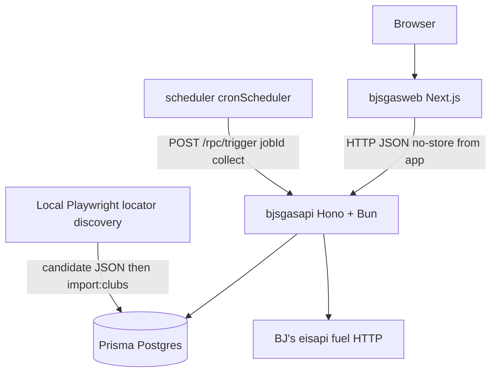

# Architecture

Current production shape of **bjs-gas**: a BJ’s fuel-price collector (approximately every two hours) and public map UI on Prisma Compute.

This document describes **what exists now**. Implementation is the source of truth. Operational how-tos live in [README.md](../README.md). Release discipline lives in [AGENTS.md](../AGENTS.md). Visual language lives in [design-system.md](design-system.md). Deliberate frontend exceptions live in [frontend-architecture-exceptions.md](frontend-architecture-exceptions.md).

---

## What this system is

Three Compute services plus Prisma Postgres:

| Service | Composer id | Role |
| --- | --- | --- |
| API | `bjsgasapi` | Hono HTTP API, collection, persistence, analytics SQL |
| Web | `bjsgasweb` | Next.js App Router UI; HTTP client of the API only |
| Scheduler | `scheduler` | Prisma native cron; typed RPC trigger into the API |
| Database | `database` | Platform-managed Prisma Postgres |

The web service does not import Prisma Client, `pg`, or other SQL drivers. All database work runs in the API process (or local CLI against `DATABASE_URL`).

Region is pinned in `prisma-composer.config.ts` to **`us-east-1`** (not the platform “inherit” default). Public Compute hostnames are operational locators, not architectural identity; see the README.

Composer injects:

- API: `rawPostgres()` URL via `service.load().db.url`; secrets `COLLECTOR_SECRET`, `HONEYBADGER_API_KEY`
- Web: HTTP dep on the API; secrets `CARTO_API_KEY`, `HONEYBADGER_API_KEY`
- Scheduler: `deps: { trigger: api.trigger }`, jobs from `src/schedule.ts`

Application code must not read `process.env` for those injected values in the deployed services. `DATABASE_URL` / `DATABASE_URL_POOLED` are reserved platform names and must not be bound with `envSecret`.



---

## Runtime topology

Declared in `module.ts`:

1. `provision(rawPostgres({ name: "database" }))`
2. `provision(apiService, { id: "bjsgasapi", deps: { db }, input: secrets })`
3. `provision(webService, { id: "bjsgasweb", deps: { api }, input: secrets })`
4. `provision(cronScheduler(), { id: "scheduler", deps: { trigger: api.trigger }, input: { jobs } })`

API entry is `src/server.ts` (Bun.serve). Composer ships `dist/` (`server.mjs` + Linux Prisma query engine) via `src/service.ts`. Web entry is `web/src/service.ts` (`nextjs` build of `web/`).

`src/server.ts` splits traffic:

- `POST /rpc/*` → Composer `serveSchedule(...)` (typed trigger)
- everything else → Hono `createApp(...)`

There is no Cloudflare Worker scheduler. Collection is Prisma-native cron only.

---

## Scheduler → collection

```text
defineSchedule({ collect: "120m" })    src/schedule.ts
        │
        ▼
cronScheduler()                        module.ts
        │  typed trigger contract
        ▼
POST /rpc/trigger { jobId: "collect" }
        │
        ▼
serveSchedule(...)                     src/server.ts
        │
        ▼
runCollection({ prisma })              src/collector/coordinator.ts
```

**Timing:** the interval is **relative to scheduler process boot** (`setInterval` semantics). The first tick is after one interval (**120 minutes**), not immediately on boot. Deploy or restart **resets** the next fire. Do not assume wall-clock minutes (`:20`, `:45`). A deploy can therefore stretch the gap between fleet runs past two hours until the new scheduler process has lived 120 minutes.

Cron logs (JSON):

| Event | Meaning |
| --- | --- |
| `cron_collection_start` | Handler began `runCollection` |
| `cron_collection_complete` | Handler finished with summary fields |
| `cron_collection_error` | Handler threw; Honeybadger notified |
| `cron_collection_skipped` | Process-local lock already held (`reason: in_progress`) |

Manual fleet collection: authenticated `POST /internal/collect` (same `runCollection`, same lock). Local: `pnpm collect:once`.

---

## Collector

Facade: `src/collector.ts` → `src/collector/`.

| Piece | Responsibility |
| --- | --- |
| `collect-clubs.ts` | Load `data/gas-clubs.json` (filesystem or bundle). This list is the fleet poll set. |
| `lock.ts` | Process-local single-flight lock. **Never auto-clears** on stale age. |
| `deadline.ts` | Wall-clock deadline + `COLLECTION_ABORTED`. |
| `policy.ts` | Concurrency and time thresholds. |
| `coordinator.ts` | Orchestrate fetch pool, empty-fuel handling, persist handoff, abort failure persist. |
| `result.ts` | Empty-fuel vs abort vs usable-run predicates. |
| `src/fuel/client.ts` | eisapi GET, retries, abort/deadline. |
| `src/gas-station-alias.ts` | Map canonical public station → upstream feed club. |

Policy (do not retune without production evidence):

- Concurrency: **5**
- Expected max duration: **3 minutes** (status `collection_over_expected_duration`; lock stays)
- Hard timeout: **12 minutes** (abort in-flight work; lock held until `finally`)
- Stale lock signal: **17 minutes** (timeout + 5m; status `collection_lock_stale`; still no auto-unlock)
- Degraded: failure ratio **> 20%**; critical warning **≥ 80%**

Per-club fuel fetch: default **10s** timeout, **3** attempts (initial + 2 retries) on 429/5xx/network with jittered backoff. Collection `AbortSignal` cancels sleeps and fetches.

Lock is **in-process**. It does not coordinate horizontally scaled API replicas. Production topology is a single API compute service.

On abort/failure (except persist watchdog hang), the coordinator persists an empty observation batch plus a **FLEET** `CollectionRun` with `collection_aborted: …` so status cannot keep showing only an older success. Watchdog timeout does **not** attempt that write and does **not** clear the lock; the process is terminated.

### Collector invariants

- Fleet polling uses **configured gas clubs** (`gas-clubs.json`), not “whoever has a current price row.”
- HTTP 200 with empty `data: []` is **not** proof the club has no gas. Log `gas_club_empty_fuels`, keep `FuelPriceCurrent`, **do not** mutate `Club.hasGas`, **do not** drop the club from the poll list.
- The collector never writes `Club.hasGas`. Only locator discovery → accept → `import:clubs` may change membership.
- Alias parents are not public gas stations; the collector polls the canonical station and fetches eisapi using `getUpstreamFuelFeedClub`.
- Persistence of a fleet (or diagnostic) batch is one bulk SQL statement (`databaseQueries === 1`). Status treats any other count as `unexpected_database_queries`.

---

## Fleet vs diagnostic collection runs

Schema enum `CollectionRunScope`: `FLEET` | `DIAGNOSTIC` (default `FLEET`).

| Scope | Writers | Status / fleet health |
| --- | --- | --- |
| **FLEET** | Native scheduler, `/internal/collect`, `collect:once`, collector success **and** abort/failure persist | **Only** these rows (`where: { scope: FLEET }`) |
| **DIAGNOSTIC** | `pnpm collect:club -- --persist` via `diagnosticCollectionRunInput` | Ignored by `/api/v1/status` |

Diagnostic persist still upserts `FuelPriceCurrent` and may insert `FuelPriceHistory`. That is price data, not a fleet health sample.

**Do not infer scope from `clubsConfigured === 1`.** A real fleet run with one configured club is still a fleet-health event (including a malformed or aborted one). Scope is explicit.

A usable fleet run (`isUsableCollectionRun`) requires `fuelObservations > 0` and no `collection_aborted` failure text.

---

## Persistence

Facade: `src/persist.ts` → `src/persistence/`.

`persistFuelObservations` (`fuel-batch.ts`):

1. Dedupe observations (`clubNumber|fuelSku`, last write wins).
2. Interactive transaction: `statement_timeout` (default 30s), client `timeout` 35s, `maxWait` 15s.
3. **One** `$queryRaw` CTE:
   - `jsonb_to_recordset` incoming observations
   - insert **history only** when no current row or `price IS DISTINCT FROM`
   - upsert **current** (price/name/source/`observedAt` always advance on conflict)
   - insert exactly one `CollectionRun` (`databaseQueries` stored as `1`)
4. Client watchdog: default **maxWait + transactionTimeout + 10s**. On expiry: log, `process.exit(1)`, lock left asserted in that dying process.

Safe retry: **at most once**, only if the transaction callback has **not** started and `isClosedConnectionError` (Prisma **P1017** / closed socket). **P2024 pool timeout is not retryable** here.

Empty observation arrays still insert a `CollectionRun` and leave current prices unchanged.

`importClubsBulk` upserts clubs and **never DELETEs** clubs omitted from a discovery import. Historical and current fuel rows for formerly active or alias-parent clubs are **not** garbage-collected automatically. Analytics/public listing filter with `Club.hasGas = true` instead.

Prices: BJ’s values like `3.919` become PostgreSQL `NUMERIC(6,3)` via exact 3-decimal **strings** (`normalizePrice`). History is change-events, not hourly snapshots. `sourcePriceAtLocal` is timezone-less BJ’s `priceDateTime` text; `observedAt` is UTC ISO for the run.

---

## Gas-station aliases

File: `data/gas-station-aliases.json`. Audit: `pnpm audit:gas-aliases`.

Some sites have a warehouse club **and** a dedicated gas kiosk. BJ’s locator may mark both `hasGas`. Physical pumps and public identity belong to the kiosk; eisapi telemetry often hangs on the warehouse number.

Map: **parent warehouse → canonical gas station**.

- Public registry / `gas-clubs.json`: canonical station only (`canonicalizeGasClubs`; import sets parent `hasGas` false).
- Collector: poll canonical number; `getUpstreamFuelFeedClub` selects the warehouse feed id when needed.
- Do **not** delete historical/current rows on the parent. Query paths that represent “a gas station” use canonical ids and `hasGas`.

---

## Discovery

| Source | Authority |
| --- | --- |
| BJ’s locator (Playwright `src/discover.ts` / `src/bjs-client.ts`) | **Membership + `hasGas`** |
| eisapi fuel HTTP | Observations only |
| `pnpm discover:sitemap-canary` | Change detector for **new** `/cl/` IDs |

Empty fuel envelopes, sitemap omissions, thin HTML, and fetch failures **do not** prove non-gas.

Maintenance flow (candidates are gitignored until accept):

```text
pnpm discover
  → data/*.candidate.json
pnpm discovery:diff
pnpm discovery:accept
pnpm import:clubs
  → rebuild + deploy so bundled gas-clubs.json updates
```

Sitemap canary alerts only on IDs in the sitemap that are missing from `data/clubs.json`. Known clubs missing from the sitemap are expected, not an alert.

---

## Canonical fuel schema

`src/fuel/schema.ts` is the **only** BJ’s upstream fuel payload schema. Collector, probe, and discovery fuel consumers share it.

- SKU: string or number → string
- Usable product: non-empty `name`, finite `price`
- `priceDateTime` optional/nullable
- Extra fields: `.passthrough()`
- Missing/`data: []`: valid envelope, inconclusive for `hasGas`
- Malformed product rows fail item schema: not persisted, not `has_products`

Observation mapping: `observationsFromFuelResponse` in `src/fuel/types.ts`. Empty arrays throw `Empty fuel array` (club-level empty-fuel failure, not a schema crash of the whole run).

---

## Shared HTTP contracts

Workspace package `@bjs-gas/contracts` (`packages/contracts`):

- Station / nearby / history DTOs
- Analytics DTOs
- Status DTOs

Rules:

- Prisma models do not leak into the web app
- Next.js types do not belong in contracts
- Contracts are the HTTP/domain exchange shapes

Web `web/lib/types.ts` re-exports station/status contracts plus local view helpers (`FuelStats`).

---

## API

`src/app.ts` (Hono). Representative routes:

| Route | Notes |
| --- | --- |
| `GET /health` | Build revision, dirty flag, configured gas club count, lock snapshot. No DB. |
| `GET /internal/probe/fuel/:clubNumber` | Collector auth. eisapi only. |
| `POST /internal/collect` | Collector auth. 409 if lock held. FLEET `runCollection`. |
| `GET /api/v1/status` | Fleet health. Read-only **P1017** retry once. Cache ~15s. |
| `GET /api/v1/stations*` | `hasGas: true` stations, detail, history, nearby. |
| `GET /api/v1/analytics/*` | summary, trends, states, movers. Admission limiter. |
| `POST /rpc/trigger` | Composer schedule (not Hono). |

Status freshness window: **180 minutes** (~3 hours). Hard-failure unhealthy ratio: **≥ 20%**. Fresh-station majority uses `stationsObservedRecently / clubsSucceeded < 0.8` on a usable attempt (`fresh_stations_below_majority`). Configured club count must match the latest FLEET attempt (`configured_clubs_mismatch`). Public UI aging is 3–6 hours; stale is **> 6 hours**.

### Database errors (do not collapse)

| Signal | HTTP | Behavior |
| --- | --- | --- |
| Prisma **P2024** (pool timeout) | **503** `database_pool_timeout` | No retry. Overload/pool pressure. |
| Limiter `QUEUE_FULL` / `QUEUE_TIMEOUT` | **503** `analytics_overloaded` | Analytics admission only. |
| Closed connection **P1017** | retry once on **read-only status**; persist acquisition retry before tx body | Not a P2024 strategy. |

Honeybadger: API `src/honeybadger.ts` (5xx and explicit collection/cron failures). Web has a separate browser/server init. Structured JSON logs for collection, persist, analytics overload, and P2024.

---

## Analytics

`src/analytics/queries.ts` is a compatibility facade.

| Module | Role |
| --- | --- |
| `national-summary.ts` | Current median/min/max |
| `trends.ts` | History series |
| `state-summary.ts` | Per-state aggregates |
| `movers.ts` | Largest recent moves |
| `fuel-info.ts` | SKU name; default SKU `"1"` (Unleaded) |
| `median.ts` | Median helper |
| `query-timing.ts` | Warn if query **> 500ms** (`analytics_query_slow`) |
| `haversine.ts` | Nearby distance |

SQL stays next to the use case. Response DTOs come from `@bjs-gas/contracts`.

**Gas-only rule:** public analytics join/filter `Club.hasGas = true`. Price tables may still hold alias-parent or formerly active rows. A fuel-specific `stationCount` can be **lower** than the public gas-station list when some `hasGas` clubs have no current row for that SKU.

Admission (`src/api/limiter.ts` singleton `analyticsLimiter`):

```text
maxConcurrency: 1
maxQueueLength: 8
maxQueueWaitMs: 8000
```

Analytics queries are serialized so they cannot monopolize the API process pool. Do not change these numbers without production evidence. Queue pressure and P2024 are **different** 503s.

---

## Frontend

Next.js App Router under `web/app`: `/`, `/map`, `/states`, `/states/[state]`, `/stations/[clubNumber]`, `/about` (`/status` permanently redirects to `/about`), plus `robots.ts` / `sitemap.ts`. Operator JSON remains `GET /api/v1/status`.

Shared behavior:

- `web/components/filters/FilterToolbar.tsx` + field controls
- `web/hooks/useStationFilters.ts`
- `web/lib/stations/*` (filter, sort, format, geojson, observations, fuels)
- `web/lib/discovery.ts` — compatibility facade over `web/lib/stations`
- `web/lib/analytics.ts` / `analytics-view.ts`, `status-view.ts`, `states-view.ts`
- MapLibre: `web/components/InteractiveMap.tsx`, `web/lib/map-config.ts`
- HTTP: `web/lib/api.ts` uses Composer `webService.load().api.url` in Compute; `cache: "no-store"` on app fetches

Pages compose; they should not reimplement filter/sort/DTO mapping.

CSS: `web/app/globals.css` imports `web/styles/{tokens,base,layout,charts,directory,map,status}.css`. See [design-system.md](design-system.md). MapLibre/Recharts/global-error hex exceptions: [frontend-architecture-exceptions.md](frontend-architecture-exceptions.md).

---

## Data model (high level)

`prisma/schema.prisma`:

- `Club` — registry; `hasGas` is locator-owned
- `FuelPriceCurrent` — latest price per club+SKU
- `FuelPriceHistory` — change events
- `CollectionRun` — one row per fleet or diagnostic attempt

Migrations live under `prisma/migrations/`. This architecture document does not prescribe new migrations.

Authoritative local snapshots: `data/clubs.json`, `data/gas-clubs.json`, `data/gas-station-aliases.json` (copied into `dist/data` at API build).

---

## Build and type safety

| Project | Covers |
| --- | --- |
| `tsconfig.json` | Core `src/**` + tests (strict, NodeNext, Node types). Excludes deploy entrypoints. |
| `tsconfig.deploy.json` | `module.ts`, `prisma-composer.config.ts`, `src/server.ts`, `src/service.ts`, `src/schedule.ts`. Bundler resolution, **Bun types**. |
| `web/tsconfig.json` | Next.js / DOM |

`pnpm typecheck` runs all three. Lint is **not** typecheck.

API build (`scripts/build-api.mjs`): Bun bundle `src/server.ts` → `dist/server.mjs` with `BUILD_REVISION` / `BUILD_DIRTY`; copy Debian OpenSSL 3 query engine; **fail if the engine file is missing/tiny**; copy data JSON into `dist/data`. Deploy requires a clean tree (`scripts/check-clean-tree.mjs`) so `/health.revision` matches git.

---

## CI and quality gates

GitHub Actions job name (required-check **context** when protection exists): **`Typecheck, Test & Build`**.

Order: frozen install → `pnpm audit --audit-level=high` → Prisma generate → Biome lint → Biome format check → typecheck → unit tests → `prisma db push` on CI Postgres → integration tests → API+web build.

Release discipline is operational: branch → PR → CI → merge → pull exact `main` → deploy that SHA → smoke. See [AGENTS.md](../AGENTS.md).

### Formatting policy

Biome **2.5.15** is installed.

- Lint is enforced on maintained source.
- Formatter exists.
- A full repository format rewrite is **not** baselined (on the order of ~167 files / ~67k lines, largely CSS wrapping).
- `format:check` currently formats/checks **`biome.json` only** (`formatter.includes`).
- Generated Prisma skills are excluded from Biome.

Do not assume `pnpm format:check` covers application source. Do not run a repo-wide `biome format --write` unless that dedicated baseline is an explicit task.

In this pnpm workspace, use `pnpm --filter bjs-gas run lint` / `format:check`. Bare `pnpm lint` is not the root script.

---

## Dependency constraints

Intentionally retained (not application imports):

| Pin | Why |
| --- | --- |
| `alchemy@2.0.0-beta.74` | Composer/Alchemy graph |
| `effect@4.0.0-rc.112` | Composer 0.18 Effect constellation |
| `@prisma/config>effect@3.21.0` | Prisma CLI 6 vs Composer Effect 4 |

Authoritative overrides: `pnpm-workspace.yaml` (also hono, undici splits, vitest, etc.). Removing or bumping these requires frozen install, typecheck, tests, build, and a real Composer deploy.

Audit ignore **`GHSA-vfj7-8cjw-p6xm`**: transitive `braces@3.0.3` via alchemy → fast-glob → micromatch. No patched `braces` release beyond 3.0.3. CI still fails any other high/critical advisory.

Prisma skills for agents are generated from installed `@prisma/composer` **0.18.0**. Canonical on-disk copy: `.agents/skills/prisma-composer-core-concepts/`. Sync with `pnpm skills:sync` (see AGENTS.md). Do not add `prisma.config.ts` while Prisma Client remains 6.x — that filename is parsed by `prisma generate` and is incompatible with the CLI 8 skills marker.

---

## Architectural invariants

1. Locator discovery owns `hasGas`. Fuel HTTP never clears gas membership.
2. Empty/`data: []` fuel responses preserve current prices and poll membership.
3. Fleet health evaluates **FLEET** `CollectionRun` rows only.
4. Diagnostic `collect:club --persist` may write prices; it is not fleet health. Never use `clubsConfigured === 1` as a proxy for diagnostic.
5. Fleet/diagnostic persistence is a **single** bulk database operation (`databaseQueries === 1`).
6. The collector must not overlap another in-process collection. Stale lock is a status signal, not an unlock.
7. Public stations and analytics scope **active gas clubs** (`hasGas = true`). Orphan price rows may remain.
8. API/web shared DTOs live in `packages/contracts`.
9. External BJ’s fuel JSON is interpreted only in `src/fuel/schema.ts`.
10. **P2024** is pool pressure (503, no retry). Closed-connection **P1017** is a separate, narrow retry.
11. Scheduler cadence is **boot-relative 120m**, not wall-clock.
12. Production is the exact merged `main` SHA (`/health.revision`, clean deploy).
13. Do not remove Composer/Effect/Alchemy pins without full deploy validation.

---

## Known intentional tradeoffs

**Formatter baseline deferred.** Lint is real; broad format normalization is not. Mixing a 67k-line wrap into unrelated PRs is worse than a narrow `format:check`.

**Playwright locator discovery.** Heavier than sitemap/HTML scraping. Retained because sitemap omits clubs, HTML can be thin, and fuel HTTP cannot classify `hasGas`.

**Compatibility facades.** `src/collector.ts`, `src/persist.ts`, `src/analytics/queries.ts`, `web/lib/discovery.ts` remain so imports do not churn. They are not extra runtime layers.

**Composer compatibility pins.** Alchemy/Effect kept after audit. Newer Alchemy on the CLI banner is not an instruction to upgrade.

**Process-local collection lock.** Sufficient for a single API replica. Not a distributed lock.

**No automatic deletion of stale fuel rows.** Safer than letting a bad discovery wipe history. Query-time `hasGas` scoping is the product filter.

---

## Future changes require evidence

The structural cleanup is complete. Further architecture work should follow **production defects, security findings, measured bottlenecks, incidents, or explicit features** — not generic refactoring.

Do not speculatively change:

- analytics limiter settings
- collector concurrency or deadline/lock thresholds
- `/api/v1/status` health rules (180m window, 20% hard-fail, query-count === 1)
- scheduler implementation or interval
- bulk SQL CTE shape
- Composer/Effect/Alchemy pins
- alias semantics
- fuel membership ownership (locator vs eisapi)

---

## Local CLI map

Scripts in root `package.json` (verify there; do not invent):

`discover`, `discover:clubs`, `discover:gas`, `discovery:diff`, `discovery:accept`, `discover:sitemap-canary`, `import:clubs`, `collect:club`, `collect:once`, `audit:gas-aliases`, `skills:sync`, `lint`, `format` / `format:check`, `typecheck` (+ `:deploy` / `:web`), `test`, `test:integration`, `prisma:generate`, `prisma:migrate`, `prisma:migrate:dev`, `build` / `build:api` / `build:web`, `deploy:compute`.
